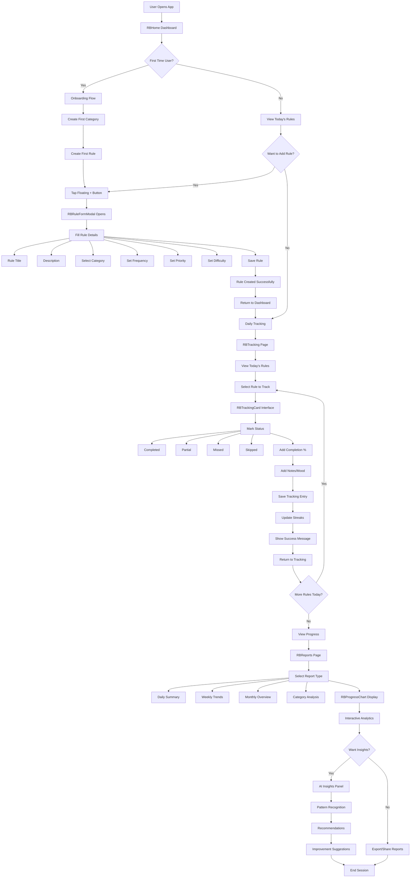
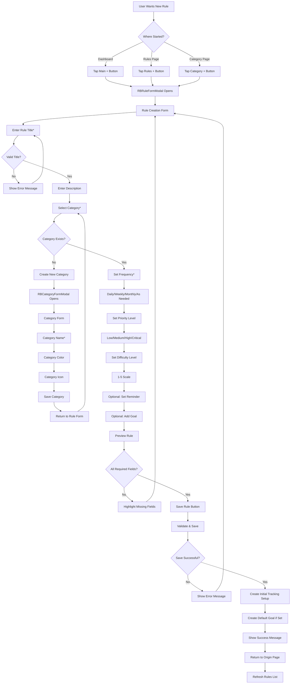
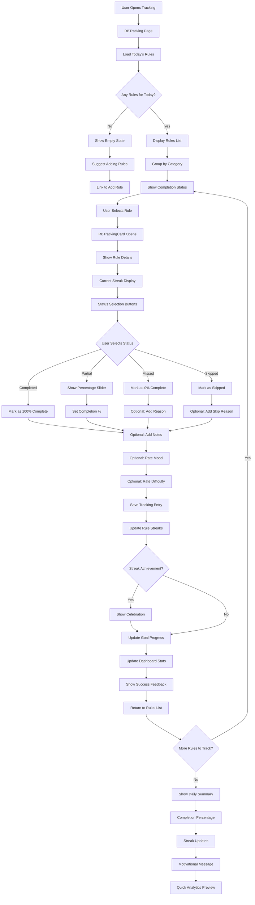
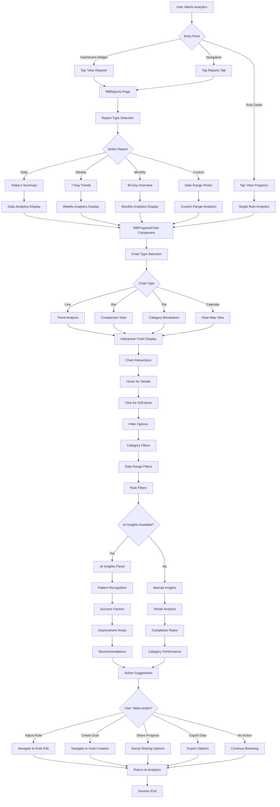
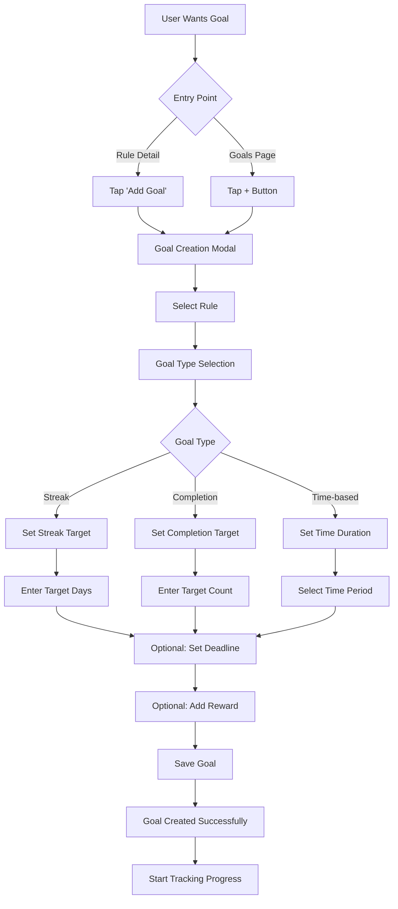
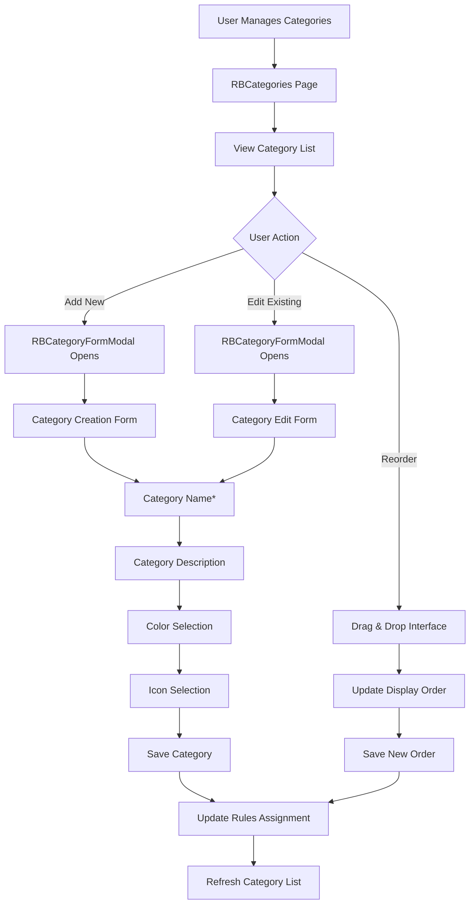

# Personal Rulebook App

A mobile-first personal rule management and tracking system built with accessibility in mind. This system allows users to create, organize, and track personal rules and principles they follow in life with an intuitive interface optimized for mobile usage and screen readers.

## Overview

Personal Rulebook is a comprehensive page schema implementation that provides:

- **Rule Management**: Create, organize, and manage personal life rules and principles
- **Category Organization**: Group rules into meaningful categories (Health, Finance, Relationships, etc.)
- **Progress Tracking**: Track adherence to rules with daily, weekly, and monthly reporting
- **Habit Building**: Transform rules into trackable habits with streak counting
  - **Streak**: A streak is the number of consecutive days or times you successfully complete a rule without missing. For example, if you complete your "Morning Run" rule for 15 days in a row, you have a 15-day streak. Streaks help motivate consistent habit formation.
- **Mobile-First Design**: Optimized for mobile devices with touch-friendly interfaces
- **Accessibility**: Screen reader friendly with proper ARIA labels and semantic HTML
- **Bottom Navigation**: Easy navigation between main sections
- **Analytics & Reports**: Comprehensive tracking and reporting system

## Graph Schema

The system uses the following Neo4j graph relationships:

```
(User)-[:UserRuleCategory]->(RuleCategory)
(User)-[:UserRule]->(Rule)-[:RuleCategory]->(RuleCategory)
(User)-[:UserRuleTracking]->(RuleTracking)-[:RuleTrackingRule]->(Rule)
(User)-[:UserRuleGoal]->(RuleGoal)-[:RuleGoalRule]->(Rule)
(User)-[:UserRuleNote]->(RuleNote)-[:RuleNoteRule]->(Rule)
(User)-[:UserRuleStreak]->(RuleStreak)-[:RuleStreakRule]->(Rule)
(User)-[:UserLanguageSetting]->(LanguageSetting {language: "en|hi|gu", isDefault: boolean})
```

### Query Patterns

When writing Cypher queries for this system, use these relationship patterns:

#### Accessing User's Rules:
```cypher
MATCH (u:User {uuid: $userUuid})-[:UserRule]->(r:Rule)
WHERE r.isActive = true
```

#### Accessing User's Rule Tracking Data:
```cypher
MATCH (u:User {uuid: $userUuid})-[:UserRuleTracking]->(rt:RuleTracking)
WHERE rt.date >= date($startDate) AND rt.date <= date($endDate)
OPTIONAL MATCH (rt)-[:RuleTrackingRule]->(r:Rule)
WHERE r.isActive = true
```

#### Accessing Categories with Tracking Data:
```cypher
MATCH (u:User {uuid: $userUuid})-[:UserRuleCategory]->(rc:RuleCategory)
WHERE rc.isActive = true
OPTIONAL MATCH (rc)<-[:RuleCategory]-(r:Rule), (u)-[:UserRuleTracking]->(rt:RuleTracking)-[:RuleTrackingRule]->(r)
WHERE rt.date >= date($startDate) AND rt.date <= date($endDate)
```

#### Accessing Streaks:
```cypher
MATCH (u:User {uuid: $userUuid})-[:UserRuleStreak]->(rs:RuleStreak)-[:RuleStreakRule]->(r:Rule)
WHERE rs.currentStreak > 0 AND rs.isActive = true AND r.isActive = true
```

#### Accessing Daily Tracking for Specific Rules:
```cypher
MATCH (u:User {uuid: $userUuid})-[:UserRule]->(r:Rule)
WHERE r.isActive = true
OPTIONAL MATCH (u)-[:UserRuleTracking]->(rt:RuleTracking)-[:RuleTrackingRule]->(r)
WHERE rt.date = date($targetDate)
```

### Vertex Types

- **User**: Existing system user vertex (extended with Rulebook properties)
- **LanguageSetting**: User's language preferences for translations
  - `language`: Language code ('en' for English, 'hi' for Hindi, 'gu' for Gujarati)
  - `isDefault`: Boolean indicating if this is the user's default language
- **RuleCategory**: User-defined categories for organizing rules
  - `key`: Unique identifier (`rule_category_${userId}_${categoryId}`)
  - `name`: Category name (e.g., "Health", "Finance", "Relationships")
  - `description`: Optional category description
  - `color`: Category color for visual organization
  - `icon`: Icon identifier for the category
  - `displayOrder`: Order for displaying categories
  - `isActive`: Boolean indicating if category is currently active
  - `createdAt`, `updatedAt`: Timestamps
- **Rule**: Individual rules or principles the user follows
  - `key`: Unique identifier (`rule_${userId}_${ruleId}`)
  - `title`: Rule title (e.g., "Exercise for 30 minutes daily")
  - `description`: Detailed rule description and reasoning
  - `type`: Rule type ('habit', 'principle', 'guideline', 'goal')
  - `frequency`: How often to track ('daily', 'weekly', 'monthly', 'as_needed')
  - `priority`: Rule priority level ('low', 'medium', 'high', 'critical')
  - `difficulty`: Difficulty level (1-5 scale)
  - `isActive`: Boolean indicating if rule is currently being followed
  - `isPublic`: Boolean for sharing rules with others (future feature)
  - `reminderTime`: Optional reminder time for the rule
  - `createdAt`, `updatedAt`: Timestamps
- **RuleTracking**: Daily tracking entries for rule adherence
  - `key`: Unique identifier (`rule_tracking_${userId}_${ruleId}_${date}`)
  - `date`: Date of the tracking entry (YYYY-MM-DD format)
  - `status`: Tracking status ('completed', 'partial', 'missed', 'skipped')
  - `completionPercentage`: Percentage completion (0-100)
  - `notes`: Optional notes about the day's adherence
  - `mood`: User's mood related to following this rule (1-5 scale)
  - `difficulty`: How difficult it was to follow the rule that day (1-5 scale)
  - `timeSpent`: Time spent on the rule (in minutes)
  - `createdAt`, `updatedAt`: Timestamps
- **RuleGoal**: Specific goals and milestones for rules
  - `key`: Unique identifier (`rule_goal_${userId}_${ruleId}_${goalId}`)
  - `title`: Goal title (e.g., "30-day streak")
  - `description`: Goal description
  - `targetValue`: Target value to achieve
  - `currentValue`: Current progress value
  - `unit`: Unit of measurement ('days', 'times', 'hours', 'percentage')
  - `targetDate`: Target completion date
  - `isCompleted`: Boolean indicating if goal is completed
  - `completedAt`: Date when goal was completed
  - `createdAt`, `updatedAt`: Timestamps
- **RuleNote**: Personal notes and reflections about rules
  - `key`: Unique identifier (`rule_note_${userId}_${ruleId}_${noteId}`)
  - `content`: Note content
  - `type`: Note type ('reflection', 'insight', 'challenge', 'success')
  - `isPrivate`: Boolean for note privacy
  - `tags`: Array of tags for organizing notes
  - `createdAt`, `updatedAt`: Timestamps
- **RuleStreak**: Streak tracking for consistent rule following
  - `key`: Unique identifier (`rule_streak_${userId}_${ruleId}`)
  - `currentStreak`: Current consecutive days/instances
  - `longestStreak`: Longest streak ever achieved
  - `totalCompletions`: Total number of completions
  - `lastCompletionDate`: Date of last completion
  - `streakStartDate`: Date when current streak started
  - `freezeCount`: Number of streak freezes used
  - `isActive`: Boolean indicating if streak is currently active
  - `createdAt`, `updatedAt`: Timestamps

## Architecture

#### Layout Components
- **RBLayout**: Main layout with navigation links at bottom

#### Modal Components
- **RBRuleFormModal**: Reusable modal component for creating and editing rules with comprehensive form validation
- **RBCategoryFormModal**: Reusable modal component for creating and editing categories with color and icon selection
- **RBGoalFormModal**: Reusable modal component for creating and editing goals with target values and deadlines

#### Page Components
- **RBHome**: Dashboard overview with today's rules and quick stats
- **RBRules**: List of all user's rules with filtering and sorting, includes integrated RBRuleFormModal for creating and editing rules
- **RBCategories**: List of rule categories with management options, includes integrated RBCategoryFormModal for creating and editing categories
- **RBTracking**: Daily tracking interface for marking rule completion
- **RBReports**: Analytics and reporting dashboard
- **RBRuleDetail**: Individual rule details with tracking history, includes integrated RBRuleFormModal for editing the rule
- **RBCategoryDetail**: Detailed view of a specific category with rules and stats, includes both RBRuleFormModal for adding rules and RBCategoryFormModal for editing the category
- **RBGoals**: Goals management and tracking page with progress visualization, includes integrated RBGoalFormModal for creating and editing goals
- **RBGoalDetail**: Individual goal details with progress tracking and related rules, includes integrated RBGoalFormModal for editing the goal
- **RBSettings**: App settings and user preferences

### API Functions

#### Core System Functions

##### getSelectOptions
- **Purpose**: Centralized management of all select field options
- **Features**:
  - Single source of truth for all dropdown options
  - Enhanced options with emojis and descriptions
  - Consistent data structure across components
  - Easy maintenance and updates
- **Returns**: Complete set of options for:
  - **Frequency options**: Daily, Weekly, Monthly, As Needed (with emojis and descriptions)
  - **Priority options**: Low, Medium, High, Critical (with color-coded emojis)
  - **Difficulty options**: 1-5 star rating system (with star emojis)
  - **Icon options**: 9 category icons with descriptions
  - **Color options**: 6 colors with personality descriptions
  - **Goal type options**: Streak, Completion, Time-based, Percentage goals
  - **Unit options**: Grouped by goal type (days, weeks, months, etc.)
- **Usage**: Called automatically by form components on mount
- **Benefits**: Eliminates hardcoded options, ensures consistency, enables easy customization

##### RBTomSelect Component
- **Purpose**: Advanced select component using TomSelect library for all form select fields
- **Features**:
  - Excellent mobile support with full-screen overlay on mobile devices
  - Touch-friendly interface with optimized mobile interactions
  - Theme-aware styling that adapts to application colors
  - Built-in search functionality for filtering options
  - Keyboard navigation support with arrow keys and Enter
  - Proper accessibility features with ARIA attributes
  - Option descriptions support for enhanced UX
  - Multiple selection support with tags display
  - Dynamic option loading via optionType/subType or manual options
  - Auto-positioning dropdowns to avoid viewport overflow
  - Reactive updates when options or values change
- **Library**: TomSelect v2.3.1 loaded via CDN
- **Integration**: Replaces all native select elements across rulebook components
- **Dependencies**: TomSelect library (loaded dynamically)
- **Styling**: Fully themed with RBTheme colors and design system
- **Mobile Features**: Full-screen overlay on mobile devices with touch-optimized interactions
- **Usage**: All form select fields in RBRuleFormModal, RBCategoryFormModal, RBGoalFormModal
- **Options Loading**: Supports both optionType (centralized) and manual options array
- **Benefits**: Production-ready library, excellent performance, mobile-optimized, extensive customization, consistent theming

#### Rule Management Functions

##### saveRule
- **Purpose**: Create or update a personal rule
- **Features**:
  - Validates rule data and user permissions
  - Creates rule with category assignment
  - Sets up initial tracking structure
  - Creates default goals if specified
- **Input**: Rule data including title, description, category, frequency, priority
- **Output**: Created rule with tracking setup

##### updateRuleStatus
- **Purpose**: Mark rule as active/inactive
- **Features**: Toggles rule status and updates tracking
- **Input**: Rule ID and new status
- **Output**: Updated rule status

##### deleteRule
- **Purpose**: Soft delete or permanently remove a rule
- **Features**:
  - Handles cascade deletion of tracking data
  - Preserves historical data for reports
- **Input**: Rule ID and deletion type (soft/hard)
- **Output**: Deletion confirmation

#### Category Management Functions

##### saveCategory
- **Purpose**: Create or update rule categories
- **Features**:
  - Validates category data
  - Ensures unique category names per user
  - Sets display order and visual properties
- **Input**: Category name, description, color, icon
- **Output**: Created category with metadata

##### reorderCategories
- **Purpose**: Update category display order
- **Features**: Batch update of category display orders
- **Input**: Array of category IDs in new order
- **Output**: Updated category orders

#### Tracking Functions

##### trackRule
- **Purpose**: Record daily rule adherence
- **Features**:
  - Records completion status and notes
  - Updates streak counters
  - Calculates completion percentages
  - Handles streak freezes
- **Input**: Rule ID, date, status, completion percentage, notes
- **Output**: Tracking record with updated streaks

##### batchTrackRules
- **Purpose**: Track multiple rules for a specific date
- **Features**: Efficient batch processing of tracking entries
- **Input**: Date and array of rule tracking data
- **Output**: Batch tracking results

##### getTrackingHistory
- **Purpose**: Retrieve tracking history for reports
- **Features**:
  - Flexible date range filtering
  - Aggregation options for different time periods
  - Statistical calculations
- **Input**: Date range, rule filters, aggregation options
- **Output**: Tracking history with statistics

#### Analytics Functions

##### generateProgressReport
- **Purpose**: Generate comprehensive progress reports
- **Features**:
  - Daily, weekly, monthly, and yearly reports
  - Category-wise breakdowns
  - Trend analysis and insights
  - Success rate calculations
- **Input**: Report type, date range, categories
- **Output**: Detailed progress report with visualizations

##### getStreakAnalytics
- **Purpose**: Analyze streak patterns and achievements
- **Features**:
  - Current and historical streaks
  - Best performing rules
  - Streak distribution analysis
- **Input**: Time period and rule filters
- **Output**: Streak analytics and insights

##### getRuleInsights
- **Purpose**: Generate AI-powered insights about rule performance
- **Features**:
  - Pattern recognition in tracking data
  - Success factor analysis
  - Improvement recommendations
- **Input**: Rule ID or category filter
- **Output**: Insights and recommendations

#### Goal Management Functions

##### createRuleGoal
- **Purpose**: Create specific goals for rules
- **Features**:
  - Goal validation and target setting
  - Progress tracking setup
  - Milestone notifications
- **Input**: Rule ID, goal type, target, deadline
- **Output**: Created goal with tracking

##### updateGoalProgress
- **Purpose**: Update goal progress based on tracking data
- **Features**: Automatic progress calculation from tracking entries
- **Input**: Goal ID and optional manual progress
- **Output**: Updated goal progress

##### editGoal
- **Purpose**: Edit existing goal with confirmation safeguards
- **Features**:
  - Pre-populated form data
  - Warning notifications about progress impact
  - Confirmation dialog for save actions
  - Delete functionality with strong warnings
- **Input**: Goal ID and updated goal data
- **Output**: Updated goal with preserved progress where appropriate

##### deleteGoal
- **Purpose**: Delete goal with complete data removal
- **Features**:
  - Confirmation dialog with progress warning
  - Complete removal of goal and progress data
  - Navigation back to goals list
- **Input**: Goal ID
- **Output**: Deletion confirmation

### Theme

- **RBTheme**: Custom theme optimized for motivation and progress tracking with high contrast for accessibility

## Mobile-First Design Principles

### Navigation
- Bottom navigation bar for primary app sections
- Large touch targets (minimum 44px)
- Swipe gestures for calendar navigation
- Floating action buttons for quick rule addition
- Quick action swipes on rule cards


### Performance
- Lazy loading for charts and analytics
- Efficient state management with SolidJS stores
- Optimized database queries
- Progressive loading of tracking history

## State Management

The system uses `args.createStore` for reactive state management:

## Internationalization (i18n)

### Language Support
The system supports multiple languages through the graph schema:
- **English (en)**: Default language
- **Hindi (hi)**: Hindi translations
- **Gujarati (gu)**: Gujarati translations

### Translation Implementation
```javascript
// Example translation function in component props:
const getTranslation = (key, language = store.currentLanguage) => {
  const translations = {
    en: {
      dashboard: 'Dashboard',
      rules: 'Rules',
      categories: 'Categories',
      tracking: 'Tracking',
      reports: 'Reports',
      add_rule: 'Add Rule',
      add_category: 'Add Category',
      completed: 'Completed',
      missed: 'Missed',
      streak: 'Streak',
      goal: 'Goal'
    },
    hi: {
      dashboard: 'डैशबोर्ड',
      rules: 'नियम',
      categories: 'श्रेणियां',
      tracking: 'ट्रैकिंग',
      reports: 'रिपोर्ट',
      add_rule: 'नियम जोड़ें',
      add_category: 'श्रेणी जोड़ें',
      completed: 'पूर्ण',
      missed: 'छूटा',
      streak: 'लगातार',
      goal: 'लक्ष्य'
    },
    gu: {
      dashboard: 'ડેશબોર્ડ',
      rules: 'નિયમો',
      categories: 'કેટેગરીઓ',
      tracking: 'ટ્રેકિંગ',
      reports: 'રિપોર્ટ્સ',
      add_rule: 'નિયમ ઉમેરો',
      add_category: 'કેટેગરી ઉમેરો',
      completed: 'પૂર્ણ',
      missed: 'ચૂકી ગયું',
      streak: 'સિલસિલો',
      goal: 'ધ્યેય'
    }
  };
  return translations[language]?.[key] || translations.en[key] || key;
};
```

### Language Setting Management
Users can set their preferred language through LanguageSetting vertex:
- One default language per user (`isDefault: true`)
- Multiple language preferences supported
- Language preference persists across sessions

## File Structure

```
/src/page_schema/rulebook/
├── components/
│   ├── RBLayout.hjson                  # Main layout with bottom nav
│   ├── RBRuleFormModal.hjson           # Modal component for creating/editing rules
│   ├── RBCategoryFormModal.hjson       # Modal component for creating/editing categories
│   ├── RBGoalFormModal.hjson           # Modal component for creating/editing goals
│   ├── RBTomSelect.hjson                # TomSelect component for all form select fields
├── pages/
│   ├── RBHome.hjson                    # Dashboard/home page
│   ├── RBRules.hjson                   # Rules management page with integrated rule modal
│   ├── RBCategories.hjson              # Categories management page with integrated category modal
│   ├── RBTracking.hjson                # Daily tracking page
│   ├── RBReports.hjson                 # Analytics and reports page
│   ├── RBRuleDetail.hjson              # Individual rule detail page with edit modal
│   ├── RBCategoryDetail.hjson          # Category detail page with rule and category edit modals
│   ├── RBGoals.hjson                   # Goals management page with integrated goal modal
│   ├── RBGoalDetail.hjson              # Individual goal detail page with integrated goal edit modal
│   └── RBSettings.hjson                # App settings page
├── themes/
│   └── RBTheme.hjson                   # Custom theme for motivation tracking
├── functions/
│   ├── saveRule.hjson                  # Create/update rules
│   ├── saveCategory.hjson              # Create/update categories
│   ├── trackRule.hjson                 # Record rule tracking
│   ├── batchTrackRules.hjson           # Batch tracking operations
│   ├── generateProgressReport.hjson     # Generate analytics reports
│   ├── getStreakAnalytics.hjson        # Streak analysis
│   ├── getRuleInsights.hjson           # AI-powered insights
│   ├── createRuleGoal.hjson            # Goal creation
│   ├── updateGoalProgress.hjson        # Goal progress updates
│   └── getTrackingHistory.hjson        # Historical tracking data
└── docs/
    └── README.md                       # This documentation
```

## User Flow Diagrams

The following diagrams illustrate the complete user journey through the Personal Rulebook app, from initial rule creation to advanced analytics and insights.

### Primary User Flow: Create Rule → Track Progress → View Analytics



### Detailed Flow 1: Rule Creation Process



### Detailed Flow 2: Daily Tracking Process



### Detailed Flow 3: Analytics & Insights Journey



### Secondary Flows

#### Goal Setting Flow


#### Category Management Flow


### User Journey Success Metrics

#### Onboarding Success
- **Goal**: 80% of new users create their first rule within 5 minutes
- **Measurement**: Time from app open to first rule creation
- **Key Points**: Simplified onboarding, clear CTAs, helpful guidance

#### Daily Engagement
- **Goal**: 70% of active users track at least one rule daily
- **Measurement**: Daily tracking completion rate
- **Key Points**: Push notifications, streak motivation, quick access

#### Long-term Retention
- **Goal**: 50% of users remain active after 30 days
- **Measurement**: Monthly active users vs new signups
- **Key Points**: Goal achievements, progress visibility, insights value

#### Feature Discovery
- **Goal**: 60% of users explore analytics within first week
- **Measurement**: Analytics page visits by new users
- **Key Points**: Dashboard widgets, progress hints, guided tours

These user flows ensure a smooth, intuitive experience that guides users from initial rule creation through long-term habit tracking and improvement insights.

## Wireframes & Visual Design

The following wireframes illustrate the layout and component structure for each major page in the Personal Rulebook app. All layouts use CSS Grid and Flexbox for modern, responsive design.

### RBHome - Dashboard Page (Mobile)

```
┌─────────────────────────────────────┐
│  ⚡ Good Morning, Sarah!        ⚙️  │
│  Tuesday, March 5, 2024             │
├─────────────────────────────────────┤
│                                     │
│  📊 Today's Progress                │
│  ┌───────────────────────────────┐ │
│  │ ████████████░░░░  75%         │ │
│  │ 6 of 8 rules completed        │ │
│  └───────────────────────────────┘ │
│                                     │
│  ┌──────────┬──────────┬──────────┐│
│  │  🔥 15   │  ✅ 6    │  📈 85%  ││
│  │ Streak   │ Complete │ This Week││
│  └──────────┴──────────┴──────────┘│
│                                     │
│  📋 Quick Actions                   │
│  ┌───────────────────────────────┐ │
│  │ 🏃 Morning Run      ○ Track   │ │
│  ├───────────────────────────────┤ │
│  │ 💊 Take Vitamins    ✓ Done    │ │
│  ├───────────────────────────────┤ │
│  │ 📚 Read 30 mins     ○ Track   │ │
│  ├───────────────────────────────┤ │
│  │ 💧 Drink Water      ○ Track   │ │
│  └───────────────────────────────┘ │
│                                     │
│  📈 Weekly Trend                    │
│  ┌───────────────────────────────┐ │
│  │     📊 Line Chart             │ │
│  │   100│ ╱╲                     │ │
│  │    75│╱  ╲  ╱╲                │ │
│  │    50│    ╲╱  ╲               │ │
│  │    25│         ╲              │ │
│  │     0└─────────────────       │ │
│  │      M T W T F S S           │ │
│  └───────────────────────────────┘ │
│                                     │
│  🏆 Recent Achievements             │
│  ┌───────────────────────────────┐ │
│  │ 🥇 7-Day Streak - Exercise    │ │
│  │ 🎯 Goal Reached - Reading     │ │
│  └───────────────────────────────┘ │
│                                     │
│                 (+)                 │
│                                     │
├─────────────────────────────────────┤
│  🏠     📋     ➕     📊     👤   │
│ Home   Rules  Track  Reports  More │
└─────────────────────────────────────┘
```

### RBRules - Rules Management Page (Mobile)

```
┌─────────────────────────────────────┐
│  ← Rules                       🔍 ⊕ │
├─────────────────────────────────────┤
│  ┌───────────────────────────────┐ │
│  │ 🔍 Search rules...            │ │
│  └───────────────────────────────┘ │
│                                     │
│  ┌──────────┬──────────┬──────────┐│
│  │   All    │  Active  │ Paused  ││
│  │   (12)   │   (8)    │  (4)    ││
│  └──────────┴──────────┴──────────┘│
│                                     │
│  🏃 Health & Fitness               │
│  ┌───────────────────────────────┐ │
│  │ ┌─┐                           │ │
│  │ │▣│ Morning Run               │ │
│  │ └─┘ Daily • High Priority     │ │
│  │     🔥 15 day streak          │ │
│  │     ────────────────────  ⋮   │ │
│  └───────────────────────────────┘ │
│  ┌───────────────────────────────┐ │
│  │ ┌─┐                           │ │
│  │ │▣│ Gym Workout              │ │
│  │ └─┘ 3x/week • Medium         │ │
│  │     🔥 8 day streak           │ │
│  │     ────────────────────  ⋮   │ │
│  └───────────────────────────────┘ │
│                                     │
│  📚 Learning & Growth              │
│  ┌───────────────────────────────┐ │
│  │ ┌─┐                           │ │
│  │ │▣│ Read for 30 minutes      │ │
│  │ └─┘ Daily • Medium Priority   │ │
│  │     🔥 23 day streak          │ │
│  │     ────────────────────  ⋮   │ │
│  └───────────────────────────────┘ │
│  ┌───────────────────────────────┐ │
│  │ ┌─┐                           │ │
│  │ │◯│ Practice Spanish         │ │
│  │ └─┘ Daily • Low Priority     │ │
│  │     ⏸️ Paused                 │ │
│  │     ────────────────────  ⋮   │ │
│  └───────────────────────────────┘ │
│                                     │
│                 (+)                 │
│                                     │
├─────────────────────────────────────┤
│  🏠     📋     ➕     📊     👤   │
│ Home   Rules  Track  Reports  More │
└─────────────────────────────────────┘
```

### RBTracking - Daily Tracking Page (Mobile)

```
┌─────────────────────────────────────┐
│  ← Daily Tracking            📅    │
│     March 5, 2024                  │
├─────────────────────────────────────┤
│  ┌───────────────────────────────┐ │
│  │ Progress: ████████░░░░  6/8   │ │
│  └───────────────────────────────┘ │
│                                     │
│  🌅 Morning Routine (2/3)          │
│  ┌───────────────────────────────┐ │
│  │ Morning Run                    │ │
│  │ ┌────┬────┬────┬────┐        │ │
│  │ │ ✅ │ ⚪ │ ❌ │ ⏭️  │        │ │
│  │ └────┴────┴────┴────┘        │ │
│  │ ▓▓▓▓▓▓▓▓▓▓▓▓▓▓░░ 85%        │ │
│  │ 🔥 Streak: 15 days            │ │
│  │ ┌───────────────────────┐     │ │
│  │ │ Add notes (optional)   │     │ │
│  │ └───────────────────────┘     │ │
│  │ Mood: 😊 😐 😕 😫 😄          │ │
│  └───────────────────────────────┘ │
│  ┌───────────────────────────────┐ │
│  │ Take Vitamins        ✓ Done   │ │
│  │ Completed at 7:30 AM          │ │
│  │ 🔥 Streak: 45 days            │ │
│  └───────────────────────────────┘ │
│  ┌───────────────────────────────┐ │
│  │ Meditation                     │ │
│  │ ┌────┬────┬────┬────┐        │ │
│  │ │ ✅ │ ⚪ │ ❌ │ ⏭️  │        │ │
│  │ └────┴────┴────┴────┘        │ │
│  │ 🔥 Streak: 8 days             │ │
│  └───────────────────────────────┘ │
│                                     │
│  📚 Learning (0/2)                 │
│  ┌───────────────────────────────┐ │
│  │ Read for 30 minutes           │ │
│  │ ┌────┬────┬────┬────┐        │ │
│  │ │ ✅ │ ⚪ │ ❌ │ ⏭️  │        │ │
│  │ └────┴────┴────┴────┘        │ │
│  │ 🔥 Streak: 23 days            │ │
│  └───────────────────────────────┘ │
│                                     │
│  [    Complete All Remaining    ]  │
│                                     │
├─────────────────────────────────────┤
│  🏠     📋     ➕     📊     👤   │
│ Home   Rules  Track  Reports  More │
└─────────────────────────────────────┘
```

### RBReports - Analytics Page (Mobile)

```
┌─────────────────────────────────────┐
│  ← Reports & Analytics         📤  │
├─────────────────────────────────────┤
│  ┌──────┬──────┬──────┬──────────┐│
│  │ Day  │ Week │Month │ Custom   ││
│  └──────┴──────┴──────┴──────────┘│
│                                     │
│  📊 Completion Rate                 │
│  ┌───────────────────────────────┐ │
│  │      Line Chart                │ │
│  │  100%│    ╱╲    ╱╲            │ │
│  │   75%│ ╱╲╱  ╲╱╲╱  ╲           │ │
│  │   50%│╱            ╲          │ │
│  │   25%│              ╲╱        │ │
│  │    0%└───────────────────     │ │
│  │      M  T  W  T  F  S  S      │ │
│  └───────────────────────────────┘ │
│                                     │
│  📈 Category Performance            │
│  ┌───────────────────────────────┐ │
│  │ Health     ████████████  92% │ │
│  │ Learning   ████████░░░░  75% │ │
│  │ Finance    ██████░░░░░░  60% │ │
│  │ Social     █████████░░░  85% │ │
│  └───────────────────────────────┘ │
│                                     │
│  🔥 Streak Leaders                  │
│  ┌───────────────────────────────┐ │
│  │ 1. Take Vitamins    🔥 45     │ │
│  │ 2. Read Daily       🔥 23     │ │
│  │ 3. Morning Run      🔥 15     │ │
│  │ 4. Meditation       🔥 8      │ │
│  └───────────────────────────────┘ │
│                                     │
│  💡 AI Insights                     │
│  ┌───────────────────────────────┐ │
│  │ 📍 Best Performance: Morning  │ │
│  │    Your completion rate is    │ │
│  │    40% higher before noon     │ │
│  │                               │ │
│  │ 📍 Suggestion: Link morning   │ │
│  │    rules into a routine       │ │
│  │                               │ │
│  │ [  View Detailed Insights  ]  │ │
│  └───────────────────────────────┘ │
│                                     │
├─────────────────────────────────────┤
│  🏠     📋     ➕     📊     👤   │
│ Home   Rules  Track  Reports  More │
└─────────────────────────────────────┘
```

### RBRuleDetail - Rule Detail Page (Mobile)

```
┌─────────────────────────────────────┐
│  ← Morning Run                 ✏️  │
├─────────────────────────────────────┤
│  ┌───────────────────────────────┐ │
│  │        🏃 Morning Run         │ │
│  │   Run for 30 minutes daily    │ │
│  │                               │ │
│  │  Category: Health & Fitness   │ │
│  │  Priority: High               │ │
│  │  Frequency: Daily             │ │
│  │  Difficulty: ⭐⭐⭐⭐⚪         │ │
│  └───────────────────────────────┘ │
│                                     │
│  ┌──────────┬──────────┬──────────┐│
│  │ Overview │ Progress │  Notes   ││
│  └──────────┴──────────┴──────────┘│
│                                     │
│  🔥 Current Streak                  │
│  ┌───────────────────────────────┐ │
│  │       15 DAYS                 │ │
│  │    🔥🔥🔥🔥🔥🔥🔥             │ │
│  │  Best: 32 days | Total: 145  │ │
│  └───────────────────────────────┘ │
│                                     │
│  📊 30-Day Performance              │
│  ┌───────────────────────────────┐ │
│  │ Week 1  ████████████  100%   │ │
│  │ Week 2  ████████░░░░   85%   │ │
│  │ Week 3  ████████████  100%   │ │
│  │ Week 4  ██████████░░   92%   │ │
│  └───────────────────────────────┘ │
│                                     │
│  📅 Calendar View                   │
│  ┌───────────────────────────────┐ │
│  │ S  M  T  W  T  F  S          │ │
│  │ ·  ·  ·  ·  1  2  3          │ │
│  │ ✅ ✅ ✅ ✅ ✅ ✅ ✅           │ │
│  │ 4  5  6  7  8  9  10         │ │
│  │ ✅ ✅ ❌ ✅ ✅ ✅ ✅           │ │
│  │ 11 12 13 14 15 16 17         │ │
│  │ ✅ ✅ ✅ ✅ ✅ ⚪ ⚪           │ │
│  └───────────────────────────────┘ │
│                                     │
│  🎯 Active Goals                    │
│  ┌───────────────────────────────┐ │
│  │ 30-Day Streak                 │ │
│  │ ████████░░░░  15/30 days     │ │
│  │ Reward: New running shoes     │ │
│  └───────────────────────────────┘ │
│                                     │
│  [      Track Today's Run       ]  │
│                                     │
├─────────────────────────────────────┤
│  🏠     📋     ➕     📊     👤   │
│ Home   Rules  Track  Reports  More │
└─────────────────────────────────────┘
```

### Desktop Layout - Dashboard (Wide Screen)

```
┌────────────────────────────────────────────────────────────────────────────┐
│  Personal Rulebook        🔍 Search        🔔  Sarah Chen  ⚙️             │
├────────────────────────────────────────────────────────────────────────────┤
│                                                                            │
│  ┌──────────────────────┬──────────────────────┬────────────────────────┐ │
│  │  📊 Today's Progress  │  🔥 Active Streaks   │  📈 Weekly Trend      │ │
│  │  ████████████░░ 75%  │  Morning Run    15d  │  ┌──────────────┐    │ │
│  │  6 of 8 completed    │  Vitamins       45d  │  │ Line Chart   │    │ │
│  │                      │  Reading        23d  │  │   📈         │    │ │
│  │  ┌────┬────┬────┐   │  Meditation      8d  │  │              │    │ │
│  │  │ ✅ │ ⏱️ │ ❌ │   │  Water Intake    3d  │  └──────────────┘    │ │
│  │  │ 6  │ 2  │ 0  │   │                      │  85% avg completion   │ │
│  │  └────┴────┴────┘   │  View All →          │  View Details →       │ │
│  └──────────────────────┴──────────────────────┴────────────────────────┘ │
│                                                                            │
│  ┌──────────────────────────────────┬────────────────────────────────────┐ │
│  │  📋 Today's Rules                 │  🏆 Recent Achievements           │ │
│  │                                   │                                   │ │
│  │  🌅 Morning (3/4)                 │  🥇 7-Day Streak                 │ │
│  │  ┌─────────────────────────────┐ │      Exercise - March 3          │ │
│  │  │ ✅ Morning Run              │ │                                   │ │
│  │  │ ✅ Take Vitamins            │ │  🎯 Goal Completed                │ │
│  │  │ ✅ Meditation               │ │      Read 20 books - March 1     │ │
│  │  │ ⏱️ Make Bed                │ │                                   │ │
│  │  └─────────────────────────────┘ │  🏅 Perfect Week                 │ │
│  │                                   │      100% completion - Feb 26    │ │
│  │  📚 Afternoon (2/3)              │                                   │ │
│  │  ┌─────────────────────────────┐ │  🌟 Milestone                     │ │
│  │  │ ✅ Read 30 minutes          │ │      100 days total - Feb 24    │ │
│  │  │ ⏱️ Practice Spanish         │ │                                   │ │
│  │  │ ✅ Review Finances          │ │  View All →                      │ │
│  │  └─────────────────────────────┘ │                                   │ │
│  │                                   │                                   │ │
│  │  🌙 Evening (0/1)                │                                   │ │
│  │  ┌─────────────────────────────┐ │                                   │ │
│  │  │ ⏱️ Journal Writing          │ │                                   │ │
│  │  └─────────────────────────────┘ │                                   │ │
│  │                                   │                                   │ │
│  │  [    Track All Remaining    ]   │                                   │ │
│  └──────────────────────────────────┴────────────────────────────────────┘ │
│                                                                            │
│  ┌──────────────────────────────────┬────────────────────────────────────┐ │
│  │  📊 Category Performance          │  💡 AI Insights                   │ │
│  │                                   │                                   │ │
│  │  Health     ████████████░  92%  │  📍 Your morning routine has      │ │
│  │  Learning   ████████░░░░░  75%  │     the highest success rate     │ │
│  │  Finance    ██████░░░░░░░  60%  │                                   │ │
│  │  Personal   █████████░░░░  85%  │  📍 Consider linking "Exercise"   │ │
│  │  Social     ████████████░  95%  │     and "Meditation" as a habit  │ │
│  │                                   │     stack for better results     │ │
│  │  View Detailed Report →           │                                   │ │
│  │                                   │  View More Insights →            │ │
│  └──────────────────────────────────┴────────────────────────────────────┘ │
│                                                                            │
│                              (+) Add New Rule                             │
│                                                                            │
└────────────────────────────────────────────────────────────────────────────┘
```

### Component Layout Patterns

#### Card Component Structure (CSS Grid)
```
┌─────────────────────────────────┐
│ .card-container (display: grid) │
│ grid-template-areas:            │
│   "icon header actions"         │
│   "content content content"     │
│   "footer footer footer"        │
│                                 │
│ ┌──┬─────────────────┬────────┐│
│ │🏃│ Rule Title      │ ⋮ Menu ││
│ ├──┴─────────────────┴────────┤│
│ │                              ││
│ │ Content Area (flex column)   ││
│ │ • Description                ││
│ │ • Progress bar               ││
│ │ • Streak counter             ││
│ │                              ││
│ ├──────────────────────────────┤│
│ │ Tags | Priority | Last Done  ││
│ └──────────────────────────────┘│
└─────────────────────────────────┘
```

#### Tracking Card Layout (Flexbox)
```
┌─────────────────────────────────┐
│ .tracking-card (display: flex)  │
│ flex-direction: column          │
│                                 │
│ ┌─────────────────────────────┐ │
│ │ Header (flex, space-between)│ │
│ │ Title            Status Icon│ │
│ └─────────────────────────────┘ │
│ ┌─────────────────────────────┐ │
│ │ Actions (flex, gap: 0.5rem) │ │
│ │ [✅] [⚪] [❌] [⏭️]         │ │
│ └─────────────────────────────┘ │
│ ┌─────────────────────────────┐ │
│ │ Progress (if partial)       │ │
│ │ ▓▓▓▓▓▓▓▓░░░░  75%         │ │
│ └─────────────────────────────┘ │
│ ┌─────────────────────────────┐ │
│ │ Notes Input (optional)      │ │
│ │ ┌───────────────────────┐  │ │
│ │ │ Add notes...          │  │ │
│ │ └───────────────────────┘  │ │
│ └─────────────────────────────┘ │
│ ┌─────────────────────────────┐ │
│ │ Metadata (flex, wrap)       │ │
│ │ 🔥 15 days | Mood: 😊       │ │
│ └─────────────────────────────┘ │
└─────────────────────────────────┘
```

### Responsive Breakpoints

#### Mobile (< 768px)
- Single column layout
- Full-width cards
- Bottom navigation
- Collapsible sections
- Touch-optimized controls

#### Tablet (768px - 1024px)
- 2-column grid for cards
- Side navigation drawer
- Expanded card details
- Hover states enabled

#### Desktop (> 1024px)
- 3-column grid layout
- Persistent sidebar
- Inline editing
- Advanced interactions
- Keyboard shortcuts

### Design System Components

#### Color Palette
```
Primary:     ████ oklch(0.65 0.25 280)
Success:     ████ oklch(0.72 0.20 145)
Warning:     ████ oklch(0.85 0.15 85)
Error:       ████ oklch(0.68 0.25 25)
Background:  ████ oklch(0.98 0.005 0)
Text:        ████ oklch(0.15 0.01 0)
```

#### Typography Scale
```
Heading 1:   32px / 1.2 / Bold
Heading 2:   24px / 1.3 / Semibold
Heading 3:   20px / 1.4 / Semibold
Body:        16px / 1.6 / Regular
Small:       14px / 1.5 / Regular
Caption:     12px / 1.4 / Regular
```

#### Spacing System
```
xs:  0.25rem (4px)
sm:  0.5rem  (8px)
md:  1rem    (16px)
lg:  1.5rem  (24px)
xl:  2rem    (32px)
xxl: 3rem    (48px)
```

These wireframes provide a comprehensive visual guide for implementing the Personal Rulebook app with modern CSS Grid and Flexbox layouts, ensuring a consistent and intuitive user experience across all devices.

## Usage Patterns

### Adding a Rule
1. Navigate to Rules page or use floating button from any page
2. Tap "Add Rule" floating button
3. Fill in rule details: title, description, category, frequency, priority
4. Set optional reminder time and difficulty level
5. Component calls `args.executeNamedServerFunction` with `saveRule` function
6. Server function validates input and creates rule structure
7. Creates initial tracking setup and default goals if specified
8. Establishes relationships following the database schema

### Daily Tracking
1. Navigate to Tracking page or Dashboard
2. View list of rules for the selected date
3. Mark each rule as completed, partial, missed, or skipped
4. Add optional notes and completion percentage
5. Component calls `args.executeNamedServerFunction` with `trackRule` function
6. Server function records tracking entry and updates streaks
7. Real-time updates to dashboard statistics and progress charts

### Category Management
1. Navigate to Categories page
2. View existing categories with rule counts and progress
3. Tap "Add Category" to create new category
4. Set category name, description, color, and icon
5. Drag and drop to reorder categories
6. Assign rules to categories during creation or editing

### Progress Reports
1. Navigate to Reports page
2. Select report type (daily, weekly, monthly, yearly)
3. Filter by categories or specific rules
4. View comprehensive analytics including:
   - Completion rates and trends
   - Streak achievements
   - Category performance
   - Goal progress
   - Insights and recommendations

### Goal Setting
1. From rule detail page, tap "Add Goal"
2. Set goal type (streak, completion count, time-based)
3. Define target value and deadline
4. Track progress automatically through daily tracking
5. Receive notifications for milestones and achievements

## Component Architecture

### Modal-Based Form Architecture
The Personal Rulebook system uses a modal-based approach for rule and category creation/editing instead of separate pages. This design decision provides several benefits:

- **Better User Experience**: Users remain in context and don't lose their place when creating or editing items
- **Consistent Navigation**: No need to handle back button states or complex navigation flows
- **Mobile-First Design**: Modals work better on mobile devices with limited screen space
- **Reusable Components**: Modal components can be integrated into any page that needs form functionality
- **State Management**: Modal state is managed through page context using SolidJS signals

#### Modal Integration Pattern
Each page that needs modal functionality includes:
1. **State Management**: SolidJS signals for modal visibility, mode (create/edit), and selected data
2. **Context Setup**: `contextName` property to organize modal data in component hierarchy
3. **Modal Component**: The actual modal component with proper context access
4. **Trigger Elements**: Buttons or UI elements that open modals with appropriate data

#### Context Data Structure
Modal components access their data through `args.contextData.[contextName]`:
```javascript
// Single modal context (e.g., RBRules page)
args.contextData.ruleModal = {
  showRuleModal: signal,
  setShowRuleModal: setter,
  modalMode: signal,
  setModalMode: setter,
  selectedRule: signal,
  setSelectedRule: setter
}

// Single goal modal context (e.g., RBGoals page)
args.contextData.goalModal = {
  showGoalModal: signal,
  setShowGoalModal: setter,
  modalMode: signal,
  setModalMode: setter,
  selectedGoal: signal,
  setSelectedGoal: setter
}

// Multiple modal contexts (e.g., RBCategoryDetail page)
args.contextData.modals = {
  ruleModal: { /* rule modal state */ },
  categoryModal: { /* category modal state */ }
}
```

### Modal Form Components
The system uses specialized modal components for creating and editing rules, categories, and goals:

#### RBRuleFormModal
- **Purpose**: Reusable modal component for creating and editing personal rules
- **Features**: Modal overlay with comprehensive rule form and validation
- **Modes**: Create mode (blank form) and Edit mode (pre-populated with existing data)
- **Styling**: Uses primary theme colors with blur backdrop
- **Server Function**: Calls `saveRule` function for rule creation/updates
- **Form Fields**:
  - Rule Title (required)
  - Description (optional but recommended)
  - Category selection (required)
  - Frequency (daily, weekly, monthly, as_needed)
  - Priority level (low, medium, high, critical)
  - Difficulty level (1-5 scale)
  - Reminder time (optional)
- **Functionality**:
  - Form validation with helpful error messages
  - Category selection with color coding
  - Real-time preview of tracking frequency
  - Delete functionality in edit mode with confirmation
  - Handles loading states and success feedback
- **Context Integration**: Uses `args.contextData.ruleModal` for state management
- **Usage**: Integrated into pages with proper context setup

#### RBCategoryFormModal
- **Purpose**: Reusable modal component for creating and editing rule categories
- **Features**: Modal overlay with category-specific form and validation
- **Modes**: Create mode (blank form) and Edit mode (pre-populated with existing data)
- **Styling**: Uses success theme colors (green) with blur backdrop
- **Server Function**: Calls `saveCategory` function for category creation/updates
- **Form Fields**:
  - Category Name (required)
  - Description (optional)
  - Color selection (from predefined palette)
  - Icon selection (from icon library)
- **Functionality**:
  - Form validation with helpful error messages
  - Visual color and icon previews
  - Delete functionality in edit mode with confirmation
  - Handles loading states and success feedback
- **Context Integration**: Uses `args.contextData.categoryModal` for state management
- **Usage**: Integrated into pages with proper context setup

#### RBGoalFormModal
- **Purpose**: Reusable modal component for creating and editing goal definitions
- **Features**: Modal overlay with goal-specific form and validation
- **Modes**: Create mode (blank form) and Edit mode (pre-populated with existing data)
- **Styling**: Uses info theme colors (blue) with blur backdrop
- **Server Function**: Calls goal management functions for creation/updates
- **Form Fields**:
  - Goal Title (required)
  - Description (optional)
  - Target Value (required)
  - Target Date/Deadline (optional)
  - Unit of Measurement (days, times, hours, percentage)
  - Related Rule selection (required)
- **Functionality**:
  - Form validation with helpful error messages
  - Target value and unit selection with previews
  - Rule selection with filtering and search
  - Delete functionality in edit mode with confirmation
  - Progress preservation warnings when editing
  - Handles loading states and success feedback
- **Context Integration**: Uses `args.contextData.goalModal` for state management
- **Usage**: Integrated into pages with proper context setup

### Tracking Components

#### RBTrackingCard
- **Purpose**: Individual rule tracking interface for daily use
- **Features**:
  - Quick status buttons (completed, partial, missed, skipped)
  - Completion percentage slider
  - Notes input field
  - Streak display
  - Visual feedback for status changes
- **Styling**: Responsive card design with status-based colors
- **Usage**:
  ```javascript
  <RBTrackingCard rule={rule} date={selectedDate} onTrack={handleTracking} />
  ```

#### RBCalendarView
- **Purpose**: Calendar interface for viewing tracking history
- **Features**:
  - Monthly calendar view
  - Color-coded completion status
  - Streak indicators
  - Quick navigation between months
  - Touch-friendly date selection
- **Usage**:
  ```javascript
  <RBCalendarView rules={rules} onDateSelect={handleDateSelect} />
  ```

### Analytics Components

#### RBProgressChart
- **Purpose**: Visual representation of progress data
- **Features**:
  - Line charts for trends
  - Bar charts for comparisons
  - Pie charts for category breakdowns
  - Interactive tooltips
  - Responsive design for mobile
- **Chart Types**:
  - Completion rate over time
  - Category performance comparison
  - Streak achievements
  - Goal progress visualization
- **Usage**:
  ```javascript
  <RBProgressChart data={analyticsData} type="completion_trend" />
  ```

#### RBStreakCounter
- **Purpose**: Display and celebrate streak achievements
- **Features**:
  - Current streak display
  - Longest streak record
  - Streak freeze indicators
  - Achievement badges
  - Motivational messages
- **Usage**:
  ```javascript
  <RBStreakCounter rule={rule} streak={streakData} />
  ```

## Development Guidelines

### Component Development
- Use RB prefix for all components
- **Modern Layout Techniques**: CSS Grid for 2D layouts, Flexbox for 1D layouts
- **Component-Scoped Styling**: All styles use `._id` selector for isolation
- **Responsive Design**: Mobile-first with different size browser support
- **Semantic HTML**: Proper landmarks and heading hierarchy
- **Atomic Design**: Build small, reusable components that combine into larger ones
- **Single Responsibility**: Each component should do one thing well
- **Composition over Inheritance**: Build complex components by combining simple ones
- Implement proper ARIA labels for tracking interfaces
- Ensure keyboard navigation for all interactive elements
- Test with screen readers for accessibility
- Optimize for mobile viewport with touch-friendly controls
- Use progressive enhancement for advanced features

### Important Guidelines

**IMPORTANT**: always follow the graph JSON structure and guidelines defined in `/src/routes/api/chat/SYSTEM_PROMPT.md`.

### Icon Guidelines
- **Use Carbon Icons only**: All icons must use Carbon Design System icons
- **Icon format**: Use `carbon:icon-name` format (e.g., `carbon:checkmark`, `carbon:close`, `carbon:add`)
- **Consistent sizing**: Use standard sizes (16px, 20px, 24px, 32px)
- **Semantic icons**: Choose icons that clearly represent their function
- **Examples**:
  - Completed: `carbon:checkmark`
  - Missed: `carbon:close`
  - Partial: `carbon:warning`
  - Add rule: `carbon:add`
  - Settings: `carbon:settings`
  - Calendar: `carbon:calendar`
  - Analytics: `carbon:analytics`
  - Goal: `carbon:target`
  - Streak: `carbon:fire`

### Data Management
- **Use contextData for data passing**: Pass data to server functions via `args.executeNamedServerFunction` contextData parameter
- **Maintain vertex format**: Always use raw vertex data without transformation
- **Batch operations**: Use batch functions for multiple tracking entries
- **Optimistic updates**: Update UI immediately, rollback on server error
- **Cache analytics**: Store computed analytics to reduce database load

### Performance Optimization
- Lazy load analytics charts and historical data
- Implement virtual scrolling for long rule lists
- Use efficient state management with SolidJS stores
- Optimize database queries with proper indexing
- Cache frequently accessed data (categories, active rules)

## API Configuration

### Database Schema Setup
The Rulebook app requires the following Neo4j constraints and indexes:

```cypher
// Unique constraints
CREATE CONSTRAINT rule_key_unique IF NOT EXISTS FOR (r:Rule) REQUIRE r.key IS UNIQUE;
CREATE CONSTRAINT rule_category_key_unique IF NOT EXISTS FOR (rc:RuleCategory) REQUIRE rc.key IS UNIQUE;
CREATE CONSTRAINT rule_tracking_key_unique IF NOT EXISTS FOR (rt:RuleTracking) REQUIRE rt.key IS UNIQUE;
CREATE CONSTRAINT rule_goal_key_unique IF NOT EXISTS FOR (rg:RuleGoal) REQUIRE rg.key IS UNIQUE;
CREATE CONSTRAINT rule_streak_key_unique IF NOT EXISTS FOR (rs:RuleStreak) REQUIRE rs.key IS UNIQUE;

// Indexes for performance
CREATE INDEX rule_user_active IF NOT EXISTS FOR (r:Rule) ON (r.userId, r.isActive);
CREATE INDEX rule_tracking_date IF NOT EXISTS FOR (rt:RuleTracking) ON (rt.date);
CREATE INDEX rule_category_user IF NOT EXISTS FOR (rc:RuleCategory) ON (rc.userId);
```

## Future Enhancements

### Advanced Features
- **AI-Powered Insights**: Machine learning analysis of tracking patterns
- **Social Features**: Share rules and progress with friends/family
- **Habit Stacking**: Link rules together for compound habit building
- **Biometric Integration**: Connect with fitness trackers and health apps
- **Voice Commands**: Voice-activated tracking and rule creation
- **Collaborative Rules**: Family or team rules with shared tracking

### Reporting & Analytics
- **Advanced Visualizations**: Heat maps, correlation analysis, trend predictions
- **Custom Reports**: User-defined report templates and automated delivery
- **Data Export**: CSV, PDF, and API exports for external analysis
- **Coaching Integration**: Connect with personal coaches or mentors
- **Challenge System**: Personal challenges and achievement systems

### Integration Features
- **Calendar Integration**: Sync with external calendars for better planning
- **Notification System**: Smart reminders based on user behavior patterns
- **Backup & Sync**: Cloud backup and multi-device synchronization
- **Offline Mode**: Full offline functionality with sync when connected
- **Widget Support**: Home screen widgets for quick tracking

### Gamification
- **Achievement System**: Badges and rewards for milestones
- **Leaderboards**: Compete with friends or community members
- **Streak Challenges**: Time-limited challenges for motivation
- **Progress Sharing**: Share achievements on social media
- **Reward Integration**: Connect achievements to real-world rewards

## Roadmap

### Phase 1: Foundation (v1.0) - Core Features
**Timeline: 2-3 months**

#### Essential Components
- [x] **Graph Schema Design**: Complete Neo4j database structure
- [ ] **Core Layout Components**:
  - [ ] RBLayout with bottom navigation
  - [ ] RBFloatingButton for quick actions
- [ ] **Rule Management**:
  - [ ] RBAddRuleButton with comprehensive form
  - [ ] RBRuleCard with modern flexbox layout
  - [ ] Basic rule CRUD operations
- [ ] **Category System**:
  - [ ] RBAddCategoryButton with color/icon selection
  - [ ] RBCategoryCard with progress indicators
  - [ ] Category management functions

#### Core Pages
- [ ] **RBHome**: Dashboard with today's rules and quick stats
- [ ] **RBRules**: Rules list with filtering and search
- [ ] **RBCategories**: Category management interface
- [ ] **RBTracking**: Daily tracking interface
- [ ] **RBSettings**: Basic app preferences

#### Core Functions
- [ ] `saveRule`: Create and update rules
- [ ] `saveCategory`: Category management
- [ ] `trackRule`: Daily tracking with status updates
- [ ] Basic analytics queries

### Phase 2: Tracking & Analytics (v2.0) - Progress Features
**Timeline: 1-2 months**

#### Enhanced Tracking
- [ ] **RBTrackingCard**: Advanced tracking interface
  - [ ] Completion percentage slider
  - [ ] Mood and difficulty tracking
  - [ ] Notes and reflections
- [ ] **RBCalendarView**: Calendar-based tracking history
- [ ] **Batch Tracking**: Multiple rules at once
- [ ] **Streak System**:
  - [ ] RBStreakCounter component
  - [ ] Streak freeze functionality
  - [ ] Achievement celebrations

#### Analytics Components
- [ ] **RBProgressChart**: Various chart types
  - [ ] Line charts for trends
  - [ ] Bar charts for comparisons
  - [ ] Pie charts for category breakdowns
- [ ] **RBReports**: Comprehensive reporting page
- [ ] `generateProgressReport`: Analytics generation
- [ ] `getStreakAnalytics`: Streak analysis

### Phase 3: Goals & Motivation (v3.0) - Achievement System
**Timeline: 1-2 months**

#### Goal Management
- [x] **RBGoals**: Goals management page with progress tracking and integrated goal modal
- [x] **RBGoalDetail**: Individual goal detail page with comprehensive stats and integrated goal edit modal
- [x] **RBGoalFormModal**: Goal creation and editing modal with validation and confirmation warnings
- [ ] **RBGoalProgress**: Enhanced goal visualization component
- [ ] `createRuleGoal`: Goal creation and tracking
- [ ] `updateGoalProgress`: Automatic progress updates
- [ ] `editGoal`: Goal editing with safeguards
- [ ] `deleteGoal`: Goal deletion with data cleanup
- [ ] Milestone notifications and celebrations

#### Gamification Features
- [ ] **Achievement Badges**: Visual progress indicators
- [ ] **Challenge System**: Time-limited challenges
- [ ] **Motivation Engine**: Inspirational quotes and tips
- [ ] **Progress Sharing**: Social media integration
- [ ] **Reward Integration**: Connect to external reward systems

### Phase 4: Intelligence & Insights (v4.0) - AI Features
**Timeline: 2-3 months**

#### AI-Powered Features
- [ ] `getRuleInsights`: Pattern recognition and recommendations
- [ ] **Smart Suggestions**: AI-powered rule recommendations
- [ ] **Habit Stacking**: Intelligent rule linking suggestions
- [ ] **Predictive Analytics**: Success probability forecasting
- [ ] **Personalized Coaching**: AI-driven improvement suggestions

#### Advanced Analytics
- [ ] **Correlation Analysis**: Identify patterns between rules
- [ ] **Mood Correlation**: Link rule completion to mood patterns
- [ ] **Time-of-Day Optimization**: Best time recommendations
- [ ] **Difficulty Adjustment**: Dynamic difficulty scaling

### Phase 5: Social & Integration (v5.0) - Community Features
**Timeline: 2-3 months**

#### Social Features
- [ ] **Family/Team Rules**: Shared rule tracking
- [ ] **Accountability Partners**: Partner tracking and support
- [ ] **Community Challenges**: Global challenges and leaderboards
- [ ] **Rule Sharing**: Public rule templates
- [ ] **Progress Sharing**: Social media integration

#### External Integrations
- [ ] **Calendar Integration**: Sync with Google Calendar, Apple Calendar
- [ ] **Fitness Trackers**: Connect with fitness devices and apps
- [ ] **Health Apps**: Integration with health monitoring apps
- [ ] **Productivity Tools**: Connect with task management apps
- [ ] **Smart Home**: Integration with IoT devices for automation

### Phase 6: Advanced Features (v6.0) - Premium Capabilities
**Timeline: 3-4 months**

#### Advanced Functionality
- [ ] **Voice Commands**: Voice-activated tracking and rule creation
- [ ] **Offline Mode**: Full offline functionality with sync
- [ ] **Multi-Device Sync**: Real-time synchronization across devices
- [ ] **Advanced Customization**: Custom themes and layouts
- [ ] **Data Export/Import**: Comprehensive backup and migration tools

#### Professional Features
- [ ] **Coaching Integration**: Connect with professional coaches
- [ ] **Advanced Reports**: Detailed analytics and insights
- [ ] **Custom Dashboards**: User-defined dashboard layouts
- [ ] **API Access**: Third-party integration capabilities
- [ ] **White-label Solution**: Customizable for organizations

### Technical Roadmap

#### Performance & Scalability
- [ ] **Phase 1**: Basic optimization and caching
- [ ] **Phase 2**: Advanced caching and lazy loading
- [ ] **Phase 3**: Database optimization and indexing
- [ ] **Phase 4**: CDN implementation and global distribution
- [ ] **Phase 5**: Microservices architecture
- [ ] **Phase 6**: Auto-scaling and load balancing

#### Mobile Development
- [ ] **Phase 1**: Responsive web design optimization
- [ ] **Phase 2**: Progressive Web App (PWA) features
- [ ] **Phase 3**: Native mobile app development
- [ ] **Phase 4**: Mobile-specific features (push notifications, widgets)
- [ ] **Phase 5**: Offline-first mobile experience
- [ ] **Phase 6**: Advanced mobile integrations

#### Security & Privacy
- [ ] **Phase 1**: Basic authentication and data encryption
- [ ] **Phase 2**: Two-factor authentication and privacy controls
- [ ] **Phase 3**: GDPR compliance and data portability
- [ ] **Phase 4**: Advanced security monitoring
- [ ] **Phase 5**: Zero-knowledge encryption options
- [ ] **Phase 6**: Enterprise-grade security features

### Success Metrics

#### User Engagement
- **Phase 1**: 70% daily active users after first week
- **Phase 2**: 50% user retention after 30 days
- **Phase 3**: Average of 5+ rules per active user
- **Phase 4**: 80% of users achieving weekly goals
- **Phase 5**: 30% of users engaging with social features
- **Phase 6**: 90% user satisfaction score

#### Technical Performance
- **Phase 1**: <2 second page load times
- **Phase 2**: 99.5% uptime
- **Phase 3**: <1 second API response times
- **Phase 4**: Support for 10,000+ concurrent users
- **Phase 5**: 99.9% uptime with global distribution
- **Phase 6**: Sub-second global response times

#### Business Goals
- **Phase 1**: Successful MVP launch with 1,000+ beta users
- **Phase 2**: 10,000+ registered users
- **Phase 3**: Premium subscription model launch
- **Phase 4**: Break-even on development costs
- **Phase 5**: 100,000+ registered users
- **Phase 6**: Sustainable profitable business model
---

This documentation serves as the foundation for implementing the Personal Rulebook system and should be referenced for all development decisions and future enhancements. The system is designed to help users build better habits, track personal growth, and maintain consistency in following their life principles.